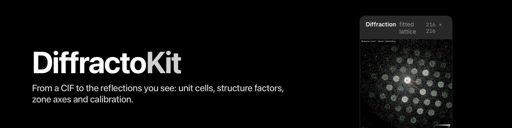

<p align="center"></p>

# DiffractoKit

[](https://github.com/mac4DSTEM/DiffractoKit/actions/workflows/ci.yml)
[](https://mac4dstem.github.io/DiffractoKit/)

Crystallography and electron diffraction as a Swift package: the numbers a scientist reads, never UI. DiffractoKit
is the Swift counterpart of the crystallography parts of **pymatgen**, **py4DSTEM** and **pyxem**: the unit cell and its
reciprocal lattice, symmetry found from the atoms, CIF import, d-spacings and the list of reflections with systematic
absences, electron scattering factors and kinematic structure factors, rings and zone axes, and the calibration of a
diffraction pattern (wavelength, camera length, reciprocal-space pixel size, the ring and ellipse fit). It is built to be
imported by tagged version into applications.

Swift 6 strict concurrency on `Foundation`, `simd`, `CryptoKit`, Metal (the ACOM matcher's optional GPU path) and
[ImagoKit](https://github.com/mac4DSTEM/ImagoKit) (its FFT, on Accelerate); no Python. Headless, one SwiftPM product per
module. The one accelerated path, `ACOMMatcher.matchAll(..., backend: .metal)`, keeps the CPU path as its reference and is
checked against it.
**Status: 0.x** ([semantic versioning](https://semver.org): a minor release may change the API, and every release has a
`CHANGELOG.md` entry with a migration note where needed). Pin an exact tag and bump on purpose.

**Platform.** Apple platforms today (macOS 15 or later, iOS 18 or later). Linux is not supported yet: `DiffractoCore` imports
`CryptoKit` and `DiffractoOrientation` depends on ImagoKit, which uses Accelerate.

## The modules

One SwiftPM product per module; a module imports only the ones above it in this table.

| Module | Holds | Since |
|---|---|---|
| `DiffractoCore` | `UnitCell` (all seven crystal systems: real and reciprocal lattice, metric, volume, d and g of an hkl, the angle between planes), `SymmetryOperation` and `PointSymmetry` (the eleven Laue classes, `LaueClass`, `CrystalSystem`), symmetry found from the atom sites (`SymmetryDetection`, `CrystalStructure`), `CIFImport` (CIF text to `CrystalStructure`, with named refusals), `ReflectionList` (every hkl up to a k_max with its systematic-absence flag), orbits and families (rings) with their names, `CrystalPresets`, the Materials Project import | 0.1.0; Niggli reduction, the conventional cell and a Cartesian symmetry tolerance 0.1.1; presets and Materials Project import 0.6.0 |
| `DiffractoScattering` | `ElectronScatteringFactors` (Lobato and Van Dyck, the table of py4DSTEM, Z = 1 to 103), `StructureFactors` (F(hkl) in A^-2), `CrystalStructure.kinematicReflections(kMax:)`: the reflections after an \|F\| cut, and their rings with the summed \|F\|^2 | 0.1.0 |
| `DiffractoGeometry` | `ElectronWavelength` (relativistic, CODATA 2018), `RingCalibration` (camera length, reciprocal-space pixel size from one ring of known d, with the refusals that say when a ring must not be calibrated from; `fit` runs the whole chain on a pattern), `EllipseCalibration` and `EllipseTransform` (the ring and detector-ellipse fit, py4DSTEM's model), `RingIndexing` (which family a measured \|q\| belongs to, and when it must not be named), `ZoneAxis` (beam directions, the detector basis, excitation errors), `LinearScale` (delta q from rings: estimate, assign, fit), single-pattern measurements (`PatternCentre`, `PatternRadialProfile`, `PatternSpot`) | 0.1.0; `LinearScale.estimate` 0.8.0; `LinearScale.assign` and `fit` and the pattern measurements 0.10.0 |
| `DiffractoOrientation` | Phase reference libraries and vector matching, Euler angles and orientation-result values; `CrystalOrientationSymmetry` (minimum-angle reduction for all 11 Laue classes), direction sampling and explicit `.py4DSTEM` / `.native` / `.orix` IPF colour keys, the ACOM matcher and scan (CPU and Metal), `OrientationMapAnalysis`, `PhaseModel`, `Misorientation` and `Orientation`, orientation-relationship variants | phase mapping and orientation results 0.3.0; orientation symmetry and the ACOM matcher 0.4.0; ACOM scans 0.5.0; the orix key, disorientation, `PhaseModel` and the Metal backend 0.6.0; map analysis 0.8.1; misorientation and variants 0.10.0; [conventions](docs/orientation-symmetry.md) |

## Install

```swift
// Package.swift
dependencies: [
    .package(url: "https://github.com/mac4DSTEM/DiffractoKit", exact: "0.11.0"), // x-release-please-version
],
targets: [
    .target(name: "MyApp", dependencies: [
        .product(name: "DiffractoCore", package: "DiffractoKit"),
        .product(name: "DiffractoScattering", package: "DiffractoKit"),
        .product(name: "DiffractoGeometry", package: "DiffractoKit"),
    ]),
]
```

The package needs macOS 15 or iOS 18 and a Swift 6.2 toolchain (`swift-tools-version: 6.2`). Its only package dependency is
[ImagoKit](https://github.com/mac4DSTEM/ImagoKit), used by `DiffractoOrientation` alone (its `FFT1D`, on Accelerate);
the system frameworks are Foundation, simd, CryptoKit and, for the optional GPU matcher, Metal. It carries no unsafe
flags: your build compiles it optimised itself; a Debug build of the reflection loops and of the ring fit is slow.
`DiffractoGeometry` depends on the other two, but each file that names a type of a module should import that module itself
(`MemberImportVisibility` is on in this package).

## First ten minutes

The program below is `Examples/diffracto-example` (run it with `swift run -c release diffracto-example`), character for
character, and `tools/readme-consumer/run.sh` proves it: that separate package compiles exactly this code against the
public API in a Debug build, with no warnings, and checks its output against the block under it. It reads gold from a CIF,
lists its rings after the |F| cut, renders a synthetic ring pattern at a camera length of 300 mm, fits the ring with
`RingCalibration.fitRing`, calibrates with `RingCalibration.calibrating`, and prints the recovered pixel size in reciprocal
space (dq) and camera length (L) beside the true ones.

```swift
// DiffractoKit, the first ten minutes (this is the README's program, character for character).
//
// Gold from a CIF -> its rings after the |F| cut -> a synthetic ring pattern at a known camera length -> the ring fitted
// and the camera calibrated back. The CIF below is written out in the program: the cubic cell of gold, a = 4.0782 A (the
// room-temperature lattice parameter, the value used throughout the kit's tests) and the four atoms of
// the face-centred basis. Run it with:  swift run -c release diffracto-example
import Foundation
import DiffractoCore
import DiffractoScattering
import DiffractoGeometry

let cifText: String = """
data_gold
_cell_length_a 4.0782
_cell_length_b 4.0782
_cell_length_c 4.0782
_cell_angle_alpha 90
_cell_angle_beta 90
_cell_angle_gamma 90
loop_
_atom_site_label
_atom_site_type_symbol
_atom_site_fract_x
_atom_site_fract_y
_atom_site_fract_z
Au1 Au 0.0 0.0 0.0
Au2 Au 0.5 0.5 0.0
Au3 Au 0.5 0.0 0.5
Au4 Au 0.0 0.5 0.5
"""

func fixed(_ x: Double, _ digits: Int) -> String { String(format: "%.\(digits)f", x) }
func sci(_ x: Double) -> String { String(format: "%.4e", x) }

do {
    // 1. The structure. A CIF that cannot be trusted throws an error that names the tag or value at fault.
    let gold: CrystalStructure = try CIFImport.read(cifText).structure
    let laue: String = gold.laueClass?.symbol ?? "?"
    print("\(gold.formula): a = \(fixed(gold.cell.a, 4)) A, Laue class \(laue), \(gold.operations.count) operations")

    // 2. The rings to k = 1/d = 1.2 per A after the |F| cut (default 1e-4): d, multiplicity and the summed |F|^2.
    let list: KinematicReflectionList = try gold.kinematicReflections(kMax: 1.2)
    print("\(list.families.count) rings, \(list.kept.count) reflections:")
    for ring in list.families.prefix(6) {
        let name: String = ring.family.name.padding(toLength: 9, withPad: " ", startingAt: 0)
        let d: String = fixed(ring.family.d, 4)
        print("  \(name) d = \(d) A  multiplicity \(ring.family.multiplicity)  sum|F|^2 = \(sci(ring.intensity)) A^-4")
    }

    // 3. A synthetic {111} ring. A camera length of 300 mm on 0.05 mm pixels is 6000 px, the electron wavelength at
    //    200 kV is lambda, and the ring sits at R = L tan(2 theta). The kit has to find R, and from it dq and L, back.
    let volts: Double = 200_000
    let pitchMM: Double = 0.05
    let lambda: Double = ElectronWavelength.angstroms(volts: volts)
    let d111: Double = list.families[0].family.d
    let trueLength: Double = 300.0 / pitchMM
    let twoTheta: Double = RingCalibration.twoTheta(wavelengthAngstroms: lambda, d: d111)
    let trueRadius: Double = trueLength * tan(twoTheta)
    let trueDeltaQ: Double = (1.0 / d111) / trueRadius
    print("lambda(200 kV) = \(fixed(lambda, 6)) A")

    let size: Int = 200
    let trueRow: Double = 100.4
    let trueColumn: Double = 99.6
    let sigma: Double = 2.2
    var pixels: [Float] = [Float](repeating: 0, count: size * size)
    for row in 0..<size {
        for column in 0..<size {
            let dr: Double = Double(row) - trueRow
            let dc: Double = Double(column) - trueColumn
            let x: Double = (dr * dr + dc * dc).squareRoot() - trueRadius
            let value: Double = exp(-x * x / (2.0 * sigma * sigma))
            pixels[row * size + column] = Float(value)
        }
    }
    let pattern: DiffractionPattern = DiffractionPattern(width: size, height: size, pixels: pixels)

    // 4. Fit the ring (start centre one click away; the annulus brackets the ring), then calibrate with its spacing.
    let ring: RingRadiusFit = try RingCalibration.fitRing(pattern: pattern, centerQX: trueRow + 1.0,
                                                          centerQY: trueColumn - 0.8, innerRadius: trueRadius - 20.0,
                                                          outerRadius: trueRadius + 20.0)
    let result: RingFitCalibration = try RingCalibration.calibrating(ring, d: d111, highTensionVolts: volts,
                                                                     pixelPitchMM: pitchMM)
    if let fit = result.fit {
        let radius: Double = (fit.a + fit.b) / 2.0
        print("fit: centre (\(fixed(fit.centerQX, 3)), \(fixed(fit.centerQY, 3))) [true (\(trueRow), \(trueColumn))], "
              + "R = \(fixed(radius, 3)) px [true \(fixed(trueRadius, 3))]")
    }
    if result.refusals.isEmpty, let calibration = result.calibration {
        let length: Double = calibration.lengthPixels ?? .nan
        let millimetres: Double = calibration.lengthMillimetres ?? .nan
        print("dq = \(sci(calibration.deltaQ)) per A per px [true \(sci(trueDeltaQ))]")
        print("L = \(fixed(length, 1)) px = \(fixed(millimetres, 2)) mm [true \(fixed(trueLength, 1)) px = 300.00 mm]")
    } else {
        print("not calibrated; refusals: \(result.refusals.map(\.name))")
    }
} catch {
    print("error: \(error.localizedDescription)")
    exit(1)
}
```

Output of the program on the machine it was written on (Apple Swift 6.4, release build); the last three lines show the planted
truth recovered:

```
Au4: a = 4.0782 A, Laue class m-3m, 192 operations
8 rings, 112 reflections:
  {1 1 1}   d = 2.3545 A  multiplicity 8  sum|F|^2 = 1.2701e+00 A^-4
  {2 0 0}   d = 2.0391 A  multiplicity 6  sum|F|^2 = 7.8331e-01 A^-4
  {2 2 0}   d = 1.4419 A  multiplicity 12  sum|F|^2 = 8.6897e-01 A^-4
  {3 1 1}   d = 1.2296 A  multiplicity 24  sum|F|^2 = 1.2543e+00 A^-4
  {2 2 2}   d = 1.1773 A  multiplicity 8  sum|F|^2 = 3.8030e-01 A^-4
  {4 0 0}   d = 1.0195 A  multiplicity 6  sum|F|^2 = 2.0531e-01 A^-4
lambda(200 kV) = 0.025079 A
fit: centre (100.400, 99.600) [true (100.4, 99.6)], R = 63.911 px [true 63.911]
dq = 6.6453e-03 per A per px [true 6.6453e-03]
L = 6000.0 px = 300.00 mm [true 6000.0 px = 300.00 mm]
```

Without a CIF, build the structure in code: `let cell = UnitCell.cubic(a: 4.0782)` and
`CrystalStructure.detectingSymmetry(cell: cell, sites: [AtomSite(z: 79, fractional: [0, 0, 0]), ...])`. For a ring whose
spacing is not yet known, `fitRing` alone gives its radius; `RingCalibration.fit` is `fitRing` followed by `calibrating` in
one call.

Conventions to know before you use a number: lengths in angstroms; reciprocal vectors **without** 2 pi (g = h b1 + k b2 +
l b3, d = 1/\|g\|, \|g\| in A^-1); the real lattice has a along x and b in the xy plane (the py4DSTEM and VESTA convention);
F(hkl) is in A^-2 (f in A over V in A^3); a pattern's rows are `qx` and its columns `qy`, as in py4DSTEM.

## Reading a result as a scientist

- A refusal is a result, not a failure: `RingCalibration` and `RingIndexing` say by name why a ring or an index must not be
  used (a conic fallback, too little of the ring, a ring wider than its annulus, an ellipse too strong to take (a + b) / 2, no
  high tension, beyond the Bragg limit). `CIFImport` throws errors that name the tag or value at fault.
- The kit never defaults an unknown. A missing high tension gives the reciprocal-space pixel size and no camera length.
- Symmetry is found from the atoms, not read from the file's operations; the file's loop is kept as `fileOperations`, and
  `fileOperationsAreSymmetries` says whether it was right.

## Oracles and pins

Every number has a reference, and the references are pinned (`CONTRIBUTING.md`):

- **pymatgen 2026.9.24** with pymatgen-core 2026.10.16, spglib 2.8.0, NumPy 2.5.4, Python 3.14.7 (cells, expanded CIF sites,
  symmetry operations, d-spacings, reflections within a sphere, the X-ray peak sums), SciPy 1.18.1 (the ring fit's
  least-squares optimum), **py4DSTEM** f050d207's `scattering_factors.txt` (sha256 `be845d1d...`, bit for bit), and the
  code of the earlier GPL-3.0 applications this library was ported from (pinned by commit in `NOTICE`) where a port must be
  bit identical.
- The pins are generated before the Swift code (`tools/pins/<subject>/`, committed as JSON under `Tests/*/Fixtures/`); the
  Swift tests read the pins and a planted truth (a closed form, a group-theory count, a cell content). Numerics are held
  to the tolerance the Python package's own tests use; readers, I/O, indices and metadata are exact. Agreement with a
  package is agreement, not truth.
- `docs/parity.md` lists, function by function, what is held against pymatgen, py4DSTEM and pyxem / diffsims / orix, and
  how each row is checked. It also says what is **not** held.
- Nothing here is validated on a real diffraction pattern: that validation belongs to the application that uses the library
  (`NOTICE`).

## Build and test

```sh
swift test -c release
tools/consumer-check/run.sh        # a separate package using the public API only
tools/readme-consumer/run.sh       # a separate package compiling exactly the README's program, checking its output
swift run -c release diffracto-example
```

`swift build --build-tests -c release` fails on current toolchains; use `swift test -c release`. The tests read committed
pins and need no Python. The Python environment that generates the pins is described in `CONTRIBUTING.md`, with a requirements
file per oracle under `tools/pins/requirements/`; the generators are under `tools/pins/<subject>/`.

## Licence

GPL-3.0-only (`LICENSE`, `NOTICE`). The code is ported from earlier GPL-3.0 applications by the same author (named, with their commits, in `NOTICE`), whose
lattice and reflection conventions follow py4DSTEM's `Crystal` class (GPL-3.0): the real-lattice matrix with a along x and b in
the xy plane, reciprocal vectors without 2 pi, the per-axis index bound. The electron scattering table of
`DiffractoScattering` is py4DSTEM's (Lobato and Van Dyck 2014), also GPL-3.0. **pymatgen** (MIT) is an oracle: cells,
symmetry and d-spacings are checked against it, and no pymatgen code is copied or ported; a part ported from pymatgen in the
future would be MIT on its own, but one package with any GPL part is GPL, so the whole is GPL-3.0 and an app built on it must
be GPL-compatible. The CIF fixtures under `Tests/` come from those applications' tests (GPL-3.0) or were written for this kit, with
their provenance in a comment line; none is a copy of a COD, AMCSD or ICSD entry. The Materials Project records are CC BY 4.0, and
`Tests/Fixtures/README.md` lists every fixture source with its licence. The beta'' cell content (Andersen et al. 1998) is written by a generator into the gitignored `References/`. Per-source notices are in `NOTICE`.

## Please cite

If you use DiffractoKit in published work, please cite it (see `CITATION.cff`), and cite the packages it is checked against
and ported from: pymatgen, spglib, py4DSTEM and, for the orientation work, pyxem / orix conventions where you rely on them.

## Known limits

- Nothing here is validated on a real diffraction pattern; the ring-fit evidence is measured on synthetic plants only.
- No database CIF (COD, ICSD) is read yet.
- theta'-Al2Cu in the orientation pins is a test structure (Al4Cu2 body-centred, a 4.04 A, c 5.80 A), not checked against a published CIF.
- With py4DSTEM's patterns the ACOM matcher finds 17 of 18 planted orientations within 4 degrees; one 2/m pattern matches another beam direction.
- One real-data test (`testRinglessFitOnARealMeanPatternFallsBackToTheConic`, a Ni65Cu35 mean pattern) is disabled until that
  dataset is published with the tests.
- Policies not yet parameters (profile-fit plausibility bounds, cell volume 1e-6) remain.
- The open list, worst first, with causes: `docs/open-items.md`; timings against Python: `docs/benchmarks.md`.

## Status and documents

0.x: the API may change between minor versions; pin an exact tag. Numbers are held to the Python reference within its own tolerance; `docs/parity.md` lists each function, its state and its tolerance.

| Document | What |
|---|---|
| `CHANGELOG.md` | what changed in each release, with migration notes |
| `docs/parity.md` | the checklist against pymatgen, py4DSTEM, pyxem / diffsims / orix |
| `docs/benchmarks.md` | the per-function timings against the Python counterparts and the backend decision |
| `docs/open-items.md` | what is open, with causes |
| `docs/orientation-symmetry.md` | orientation conventions |
| `tools/consumer-check/README.md` | the separate package that uses the public API only |
| `tools/readme-consumer/README.md` | the separate package that compiles and runs exactly this README's program |
| `Sources/*/*.docc` | the DocC catalogues: one landing page and one article per module |
| `CONTRIBUTING.md` | how to build, test and contribute |
